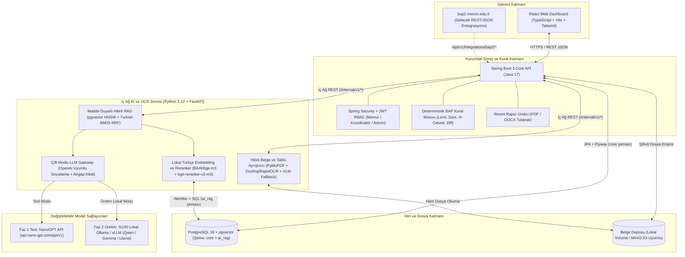
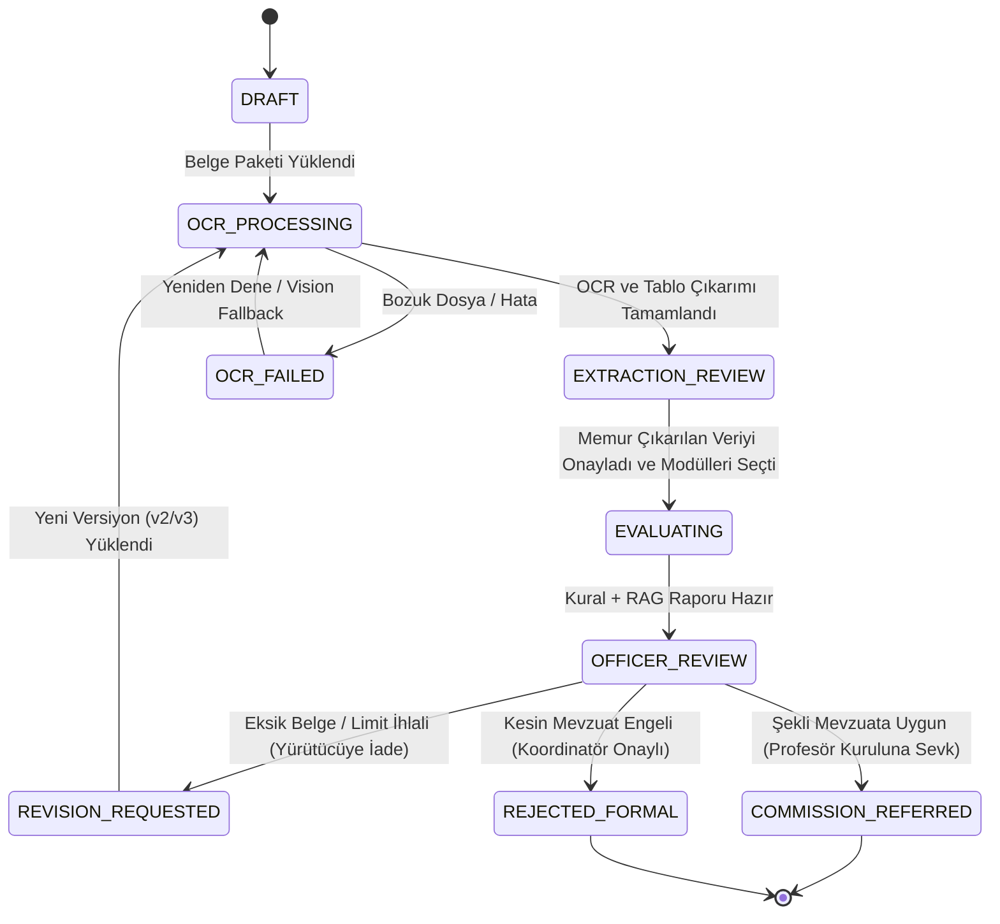
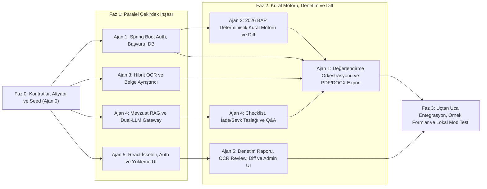

# MEÜ BAP Mevzuat Uygunluk ve Ön İnceleme Sistemi — Çoklu Ajan İnşa Planı (Multi-Agent Build Plan)

> **Proje Kodu:** `bap-advisor`  
> **Hedef Kurum:** Mersin Üniversitesi Bilimsel Araştırma Projeleri (BAP) Koordinasyon Birimi  
> **Mimari:** Spring Boot 3 (`core-api`) + Python FastAPI (`ai-engine`) + React TypeScript (`web-dashboard`) + PostgreSQL 16 (`pgvector`)  
> **Çalışma Modu:** Çift Modlu LLM Katmanı (`NanoGPT` Test Fazı $\rightarrow$ `Ollama / vLLM` %100 Lokal Üretim Fazı)

---

## 1. Yönetici Özeti ve Kapsam Sınırları

### 1.1. Çözülen Problem
Öğretim elemanlarının BAP Otomasyon Sistemi (`bap2.mersin.edu.tr`) üzerinden oluşturup çoğu zaman ıslak imzalı ve ek belgeli (proforma fatura, teknik şartname, etik kurul belgesi, yayın kanıtı vb.) olarak sunduğu talepler, Profesör Kuruluna (BAP Komisyonu) çıkmadan önce BAP Koordinasyon Birimi personelinin ön incelemesinden geçmektedir. Personelin her proje alanına veya yüzlerce sayfalık mevzuat/bütçe/ihale detayına aynı anda hâkim olamaması gecikmelere ve hatalı sevk/iade süreçlerine yol açmaktadır.

### 1.2. Sistemin Amacı ve Kesin Sınır Çizgisi (Guardrail)
- **YAPACAKLARI (Şekli, İdari ve Mali Mevzuat Denetimi):**
  - Yarı-düzenli, taranmış veya dijital tüm başvuru belgelerini hibrit OCR ile ayrıştırmak.
  - 2026 yılı proje destek üst limitleri (`TP1`–`AP9`), Açık Erişim (`Q1`/`Q2`) tavanları, azami proje süresi (`36 ay`), H Cetveli gündelik limitleri, zorunlu ek belgeler ve ıslak imza varlığını **deterministik kurallarla** denetlemek.
  - MEÜ BAP Yönergesi, Uygulama Usul ve Esasları, YÖK BAP Yönetmeliği ve İhale/Bütçe mevzuatına göre **madde atıflı RAG uygunluk kontrolü** yapmak.
  - Görevlinin seçtiği modüllere göre **Eksik/Revizyon İade Yazısı**, **Komisyona Sevk Özeti**, **Etkileşimli Mevzuat Soru-Cevap** ve **Resmi PDF/DOCX Ön İnceleme Tutanağı** üretmek.
  - Çok kullanıcılı süreç takibi (`Memur`, `Koordinatör`, `Yönetici`), `v1` $\leftrightarrow$ `v2` revizyon fark (diff) analizi ve birim istatistiklerini sunmak.
- **KESİNLİKLE YAPMAYACAKLARI (Bilimsel Hakemlik Yasağı):**
  - Sistem projenin **bilimsel özgünlüğünü, akademik değerini, literatür katkısını veya metodolojik kalitesini değerlendirmez**. Bilimsel takdir yetkisi yalnızca BAP Komisyonu / Profesör Kuruluna aittir; belirsiz veya akademik takdir gerektiren her nokta otomatik olarak `COMMISSION_REVIEW_REQUIRED` (*Komisyon Takdirine Sunulmalı*) olarak işaretlenir.

### 1.3. Desteklenen Tüm BAP Talep Türleri (`SubmissionType`)
1. `NEW_PROJECT`: Yeni Proje Başvuruları (`TP1`, `TP2`, `TP3`, `AP1`, `AP2`, `AP3`, `AP4`, `AP7`, `AP9`)
2. `OPEN_ACCESS`: Açık Erişim (Open Access) Yayın Basım Ücreti Desteği (`WOS_Q1_TOP10`, `WOS_Q1_OTHER`, `WOS_Q2`)
3. `ADDITIONAL_BUDGET`: Ek Bütçe Talepleri (mevcut bütçe + ek bütçe tavan kontrolü, gerekçe ve ıslak imza kontrolü)
4. `ADDITIONAL_TIME`: Ek Süre Talepleri (toplam süre $\le$ 36 ay kontrolü, ara rapor/gerekçe ve ıslak imza kontrolü)
5. `PROCUREMENT_ADVANCE`: Satın Alma, Avans Açma/Kapatma ve Yolluk/Gündelik Talepleri (proforma/şartname, doğrudan temin sınırı, 2026 H Cetveli gündelik kontrolü, ıslak imza kontrolü)

---

## 2. Sistem Mimarisi ve Veri Akışı

### 2.1. Konteyner ve Servis Topolojisi



### 2.2. Başvuru Yaşam Döngüsü Durum Makinesi (`SubmissionStatus`)



> [!IMPORTANT]
> **`EXTRACTION_REVIEW` (İnsan Doğrulamalı OCR Adımı):** Yarı-düzenli ve ıslak imzalı taranmış formlarda OCR motoru örneğin `125.000,00 TL` değerini `725.000,00 TL` okuyabilir. Değerlendirme öncesi veya rapor ekranında görevli, çıkarılan yapısal alanları (Proje Türü, Talep Edilen Bütçe, Süre, Kalemler, İmza Durumu) orijinal PDF ile yan yana görüp tek tıkla düzeltebilir; düzeltme yapıldığında deterministik kurallar `<100ms` içinde anında yeniden hesaplanır.

---

## 3. Monorepo Dizin Yapısı ve Ajan Sahiplik Matrisi

Farklı ajanların aynı anda çakışma (merge conflict) yaşamadan çalışabilmesi için monorepo katı dizin sınırlarına bölünmüştür:

```text
bap-advisor/
├── AGENTS.md                         # Tüm ajanlar için hızlı başlangıç ve çalışma kuralları
├── BUILD_PLAN.md                     # Bu ana mimari ve inşa planı dokümanı
├── .env.example                      # Ortam değişkenleri şablonu (NanoGPT + Lokal Ollama/vLLM)
├── docker-compose.yml                # Tam yığın orkestrasyonu (postgres, core-api, ai-engine, web)
├── docker-compose.dev.yml            # Sadece altyapı (postgres+pgvector, minio) lokal geliştirme için
├── Makefile                          # Tek komutluk kurulum, test ve başlatma hedefleri
├── contracts/                        # [AJAN 0 SAHİPLİĞİ] Servisler arası değişmez kontratlar
│   ├── openapi-core-public.yaml      # React <-> Spring Boot REST kontratı
│   ├── openapi-ai-internal.yaml      # Spring Boot <-> Python AI iç servis kontratı
│   ├── schemas/                      # Ortak JSON Schema tanımları (ExtractedForm, RuleResult vb.)
│   └── seed-data/                    # 2026 MEÜ BAP limitleri JSON + mevzuat manifestosu
├── scripts/                          # [AJAN 0 SAHİPLİĞİ] Kurulum, mevzuat indirme ve test scriptleri
│   ├── dev-bootstrap-mac.sh          # Mac ortamı hazırlayıcı (uv python 3.12, jdk 17, pgvector)
│   ├── fetch-meu-regulations.py      # Erişilebilir 7 MEÜ PDF'ini indiren script
│   └── generate-sample-forms.py      # Test için gerçekçi/taranmış görünümlü örnek BAP formları üretici
├── services/
│   ├── core-api/                     # [AJAN 1 ve AJAN 2 SAHİPLİĞİ] Spring Boot 3.4+ (Java 17, Maven)
│   │   ├── mvnw
│   │   ├── pom.xml
│   │   └── src/main/
│   │       ├── resources/db/migration/ # Flyway SQL (yalnızca "core" şeması!)
│   │       └── java/tr/edu/mersin/bapadvisor/
│   │           ├── auth/             # [AJAN 1] JWT, Spring Security, RBAC
│   │           ├── submission/       # [AJAN 1] Başvuru, Versiyonlama (v1/v2), Dosya Yönetimi
│   │           ├── evaluation/       # [AJAN 1] Orkestrasyon, Seçilebilir Modüller, Rapor Export
│   │           ├── regulation/       # [AJAN 1] Mevzuat ve Yıllık Limit Yönetim Uçları
│   │           ├── analytics/        # [AJAN 1] Koordinatör İstatistik Servisleri
│   │           ├── integration/      # [AJAN 1] bap2.mersin.edu.tr Import/Export REST Uçları
│   │           └── rules/            # [AJAN 2 İZOLE PAKET] Deterministik Kural Motoru ve Diff Hesaplayıcı
│   └── ai-engine/                    # [AJAN 3 ve AJAN 4 SAHİPLİĞİ] Python 3.12 + FastAPI (uv)
│       ├── pyproject.toml
│       ├── alembic/                  # Alembic (yalnızca "ai_rag" şeması!)
│       └── app/
│           ├── main.py               # FastAPI uygulama girişi ve iç API router'ları
│           ├── config.py             # Pydantic Settings (NanoGPT / Ollama / Airgap ayarları)
│           ├── ocr/                  # [AJAN 3 İZOLE PAKET] Hibrit OCR, Tablo/Form/İmza Çıkarımı
│           ├── parsers/              # [AJAN 3 İZOLE PAKET] PDF, DOCX, XLSX, Görsel, ZIP ayrıştırıcılar
│           ├── rag/                  # [AJAN 4 İZOLE PAKET] Madde-duyarlı Chunker, bge-m3, RRF Arama
│           ├── llm/                  # [AJAN 4 İZOLE PAKET] NanoGPT <-> Ollama/vLLM Gateway
│           └── evaluator/            # [AJAN 4 İZOLE PAKET] Checklist, İade/Sevk Taslağı, Soru-Cevap
└── apps/
    └── web-dashboard/                # [AJAN 5 SAHİPLİĞİ] React 19 + TypeScript + Vite + Tailwind
        ├── package.json
        └── src/
            ├── api/                  # OpenAPI'den türetilmiş tip güvenli istemci + TanStack Query
            ├── auth/                 # Oturum ve Rol Korumalı Rotalar (Memur / Koordinatör / Admin)
            ├── pages/
            │   ├── DashboardPage.tsx # İstatistikler ve bekleyen iş listesi
            │   ├── NewSubmissionPage.tsx # Çoklu dosya yükleme + Modül seçimi sihirbazı
            │   ├── ExtractionReviewPage.tsx # Yan yana PDF + OCR veri doğrulama ekranı
            │   ├── AuditReportPage.tsx # Hibrit Checklist + İade/Sevk Metni + Soru-Cevap Paneli
            │   ├── VersionDiffPage.tsx # v1 <-> v2 Revizyon Karşılaştırma ekranı
            │   ├── RegulationsAdminPage.tsx # Mevzuat PDF yükleme + 2026 Limit Tablosu editörü
            │   └── SystemSettingsPage.tsx # NanoGPT <-> Lokal Ollama geçişi ve sistem sağlığı
            └── components/
```

### 3.1. Ajan Görev ve Sınır Tablosu

| Ajan Kodu | Rol Adı | Yazma Yetkili Olduğu Tek Dizin | Salt-Okunur Bağımlılıkları |
| :--- | :--- | :--- | :--- |
| **Ajan 0** | `Infra & Contracts Architect` | `contracts/`, `scripts/`, `docker-compose*.yml`, `Makefile`, `.env.example` | `BUILD_PLAN.md` |
| **Ajan 1** | `Spring Boot Core & Workflow` | `services/core-api/` (`rules/` paketi hariç) | `contracts/` |
| **Ajan 2** | `BAP Deterministic Rule Engine` | `services/core-api/src/main/java/.../rules/`, `src/test/java/.../rules/` | `contracts/seed-data/`, `submission` DTO'ları |
| **Ajan 3** | `Hybrid OCR & Form Extractor` | `services/ai-engine/app/ocr/`, `services/ai-engine/app/parsers/`, `tests/ocr/` | `contracts/schemas/` |
| **Ajan 4** | `Turkish Legal RAG & Dual-LLM` | `services/ai-engine/app/rag/`, `app/llm/`, `app/evaluator/`, `alembic/` | `contracts/openapi-ai-internal.yaml` |
| **Ajan 5** | `React Process & Audit UI` | `apps/web-dashboard/` | `contracts/openapi-core-public.yaml` |

---

## 4. Veritabanı Tasarımı (PostgreSQL 16 + `pgvector` Çift Şema İzolasyonu)

Tek bir PostgreSQL veritabanı (`bap_advisor`) içinde migration çakışmasını sıfırlamak için iki ayrı şema kullanılır:

### 4.1. `core` Şeması (Spring Boot Flyway Yönetimi)

1. **`core.users`**: `id (UUID)`, `email (UNIQUE)`, `password_hash`, `full_name`, `role (ENUM: ADMIN, COORDINATOR, OFFICER, COMMISSION_VIEWER)`, `is_active`, `created_at`
2. **`core.project_limit_configs`** *(Yıllık Dinamik Limit Tablosu)*:
   - `id (UUID)`, `fiscal_year (INT, ör. 2026)`, `rule_category (ENUM: PROJECT_BUDGET, OPEN_ACCESS, PER_DIEM, DURATION, PROCUREMENT)`, `code (VARCHAR, ör. TP1, AP4, WOS_Q1_TOP10, MAX_MONTHS_NON_THESIS)`, `title_tr`, `max_amount_tl (NUMERIC(15,2))`, `max_duration_months (INT)`, `currency (DEFAULT 'TRY')`, `vat_included (BOOLEAN)`, `conditions_json (JSONB)`, `effective_from (DATE)`, `is_active (BOOLEAN)`, `updated_by (UUID)`
3. **`core.submissions`** *(Ana Talep Kaydı)*:
   - `id (UUID)`, `reference_no (VARCHAR, ör. BAP-2026-00142)`, `external_bap2_id (VARCHAR, NULLABLE)`, `submission_type (ENUM: NEW_PROJECT, OPEN_ACCESS, ADDITIONAL_BUDGET, ADDITIONAL_TIME, PROCUREMENT_ADVANCE)`, `project_code (VARCHAR, ör. TP2, AP2)`, `title`, `applicant_name`, `applicant_title (ör. Prof. Dr., Öğr. Gör. Dr.)`, `department`, `current_version_no (INT)`, `status (SubmissionStatus)`, `assigned_officer_id (UUID)`, `created_by (UUID)`, `created_at`, `updated_at`
4. **`core.submission_versions`** *(Her Revizyon `v1`, `v2`, `v3` İçin Ayrı Kayıt)*:
   - `id (UUID)`, `submission_id (UUID FK)`, `version_no (INT)`, `extracted_metadata_json (JSONB — OCR ile çıkarılan ve memurun doğruladığı yapısal form verisi)`, `selected_modules_json (JSONB — seçilen değerlendirme modülleri)`, `officer_notes`, `submitted_at`
5. **`core.submission_documents`**:
   - `id (UUID)`, `version_id (UUID FK)`, `file_name`, `mime_type`, `file_size_bytes`, `storage_path`, `sha256_hash`, `doc_role (ENUM: APPLICATION_FORM, BUDGET_TABLE, PROFORMA_INVOICE, TECHNICAL_SPEC, ETHICS_APPROVAL, THESIS_PROPOSAL, SIGNED_PETITION, PUBLICATION_PROOF, OTHER)`, `ocr_status`, `ocr_confidence (NUMERIC(4,3))`, `has_signature_detected (BOOLEAN)`, `parsed_markdown (TEXT)`, `parsed_tables_json (JSONB)`
6. **`core.evaluations`**:
   - `id (UUID)`, `version_id (UUID FK)`, `llm_provider_used (VARCHAR: NANOGPT / OLLAMA / VLLM)`, `llm_model_name`, `overall_compliance_status (ENUM: COMPLIANT, NEEDS_REVISION, COMMISSION_REVIEW, FORMAL_REJECTION)`, `deterministic_score_summary (JSONB)`, `revision_draft_tr (TEXT)`, `commission_referral_summary_tr (TEXT)`, `started_at`, `completed_at`
7. **`core.evaluation_findings`** *(Birleşik Deterministik + RAG Checklist Kalemleri)*:
   - `id (UUID)`, `evaluation_id (UUID FK)`, `source_type (ENUM: DETERMINISTIC_RULE, RAG_LLM)`, `rule_code (VARCHAR)`, `category (BUDGET, DURATION, ELIGIBILITY, DOCUMENTS, PROCUREMENT, OPEN_ACCESS, FORMAL_SIGNATURE)`, `severity (ENUM: COMPLIANT, VIOLATION, MISSING_DOCUMENT, AMBIGUOUS_COMMISSION)`, `title_tr`, `explanation_tr`, `regulation_doc_name`, `regulation_article_ref (ör. MEÜ BAP Yönergesi Madde 11/3)`, `verbatim_quote (TEXT)`, `expected_value`, `actual_value`, `officer_override_status (NULLABLE)`, `officer_override_reason (TEXT)`
8. **`core.qa_messages`** *(Etkileşimli Soru-Cevap Geçmişi)*:
   - `id (UUID)`, `version_id (UUID FK)`, `user_id (UUID FK)`, `role (USER / ASSISTANT)`, `content`, `citations_json (JSONB)`, `created_at`
9. **`core.audit_logs`**:
   - `id (UUID)`, `actor_user_id`, `action_type`, `entity_type`, `entity_id`, `before_json`, `after_json`, `ip_address`, `created_at`

### 4.2. `ai_rag` Şeması (Python Alembic Yönetimi)

1. **`ai_rag.regulation_documents`**:
   - `id (UUID)`, `slug`, `title_tr`, `doc_type (YONETMELIK, YONERGE, KILAVUZ, ESASLAR, REHBER, CETVEL)`, `version_label`, `source_url`, `storage_path`, `sha256_hash`, `is_active (BOOLEAN)`, `ingested_at`
2. **`ai_rag.regulation_chunks`**:
   - `id (UUID)`, `regulation_doc_id (UUID FK)`, `chunk_index (INT)`, `section_title`, `article_number (VARCHAR, ör. MADDE 14)`, `sub_clause (ör. Fıkra 2)`, `content_text (TEXT)`, `content_tsv (TSVECTOR — Türkçe tam metin indeksi)`, `embedding (VECTOR(1024) — BAAI/bge-m3)`, `metadata_json (JSONB: geçerli proje kodları, talep türleri, sayfa no)`
   - **İndeksler:** `HNSW (embedding vector_cosine_ops)` + `GIN (content_tsv)` + `BTREE (article_number)`

---

## 5. Servisler Arası Kesin API Kontratları

### 5.1. İç Servis Kontratı (`core-api` $\rightarrow$ `ai-engine` `:8001/internal/v1`)

Tüm iç isteklerde `X-Internal-Service-Token` başlığı zorunludur.

1. **`POST /internal/v1/ocr/extract`**
   - **Girdi:** `{ "version_id": "uuid", "files": [{ "doc_id": "uuid", "storage_path": "...", "mime_type": "..." }], "enable_vision_fallback": true }`
   - **Çıktı:** Belge bazında `doc_role` sınıflandırması, `ocr_confidence`, `has_signature_detected`, Markdown metni, çıkarılan tablolar (`parsed_tables_json`) ve birleştirilmiş `StructuredSubmissionData` JSON nesnesi:
     ```json
     {
       "detected_submission_type": "NEW_PROJECT",
       "detected_project_code": "TP2",
       "applicant_title": "Doç. Dr.",
       "requested_budget_total_tl": 132500.00,
       "existing_approved_budget_tl": null,
       "requested_duration_months": 18,
       "existing_duration_months": null,
       "budget_line_items": [
         { "category": "CONSUMABLE", "name": "Kimyasal Sarf", "quantity": 2, "unit_price_tl": 45000.00, "total_tl": 90000.00, "vat_included": true },
         { "category": "TRAVEL", "name": "Yurtiçi Arazi Yolluk", "days": 10, "daily_rate_tl": 1250.00, "total_tl": 12500.00 },
         { "category": "SERVICE_PURCHASE", "name": "Analiz Hizmeti", "total_tl": 30000.00 }
       ],
       "journal_quartile": null,
       "wet_signature_present": true,
       "ethics_required_keywords_detected": false,
       "detected_attachments": ["APPLICATION_FORM", "PROFORMA_INVOICE"]
     }
     ```
2. **`POST /internal/v1/regulations/ingest`**
   - **Girdi:** `{ "regulation_doc_id": "uuid", "storage_path": "...", "title_tr": "...", "doc_type": "YONERGE", "replace_previous_slug": "meu-bap-yonergesi" }`
   - **Davranış:** Taranmış sayfaları OCR'dan geçirir, `BÖLÜM` / `MADDE` / `GEÇİCİ MADDE` sınırlarına göre parçalar, `BAAI/bge-m3` ile lokal vektörler ve `ai_rag.regulation_chunks` tablosuna yazar.
3. **`POST /internal/v1/evaluate`**
   - **Girdi:** Doğrulanmış `StructuredSubmissionData`, belge Markdown içerikleri, Spring Boot kural motorunun bulduğu `deterministic_findings[]` listesi ve görevlinin seçtiği modül bayrakları (`run_rag_checklist`, `generate_action_drafts`).
   - **Çıktı:** Madde atıflı `rag_findings[]`, `revision_draft_tr`, `commission_referral_summary_tr`, kullanılan model bilgisi.
4. **`POST /internal/v1/qa/ask`**
   - **Girdi:** `{ "version_id": "uuid", "question": "Bu projede talep edilen dizüstü bilgisayar kalemi TP2 tez projesinde desteklenebilir mi?", "submission_context": {...}, "chat_history": [...] }`
   - **Çıktı:** Sadece ilgili mevzuat maddelerine ve proje dosyasına dayalı kaynakçalı yanıt (`answer_tr`, `citations[]`).
5. **`GET /internal/v1/providers/status` & `PUT /internal/v1/providers/config`**
   - Aktif LLM sağlayıcısını (`NANOGPT` veya `OLLAMA` / `VLLM`), aktif modeli ve `airgapped_mode` kilidini sorgular/günceller.

### 5.2. Dış REST Kontratı (`web-dashboard` $\leftrightarrow$ `core-api` `:8080/api/v1`)

- **Auth:** `POST /api/v1/auth/login`, `POST /api/v1/auth/refresh`, `GET /api/v1/auth/me`
- **Başvurular ve Versiyonlar:**
  - `GET /api/v1/submissions` (filtreleme: `status`, `submissionType`, `projectCode`, `assignedOfficer`, tarih aralığı)
  - `POST /api/v1/submissions` (yeni başvuru oluşturma)
  - `POST /api/v1/submissions/{id}/versions` (çoklu dosya/ZIP veya serbest metin yükleme $\rightarrow$ `v1`, `v2`...)
  - `GET /api/v1/submissions/{id}/versions/{v}` (çıkarılan OCR verisi ve belgeler)
  - `PATCH /api/v1/submissions/{id}/versions/{v}/extracted-data` (memurun OCR verisini düzeltip onaylaması)
  - `POST /api/v1/submissions/{id}/versions/{v}/evaluate` (seçilebilir modül parametreleriyle değerlendirme başlatma)
  - `GET /api/v1/submissions/{id}/diff?fromVersion=1&toVersion=2` (`v1` $\leftrightarrow$ `v2` bütçe, süre, belge ve ihlal fark raporu)
  - `PATCH /api/v1/submissions/{id}/status` (İade, Komisyona Sevk, Bulgu Override + Audit Log)
  - `GET /api/v1/submissions/{id}/versions/{v}/export?format=pdf|docx` (Resmi Ön İnceleme Tutanağı indirme)
- **Soru-Cevap:** `POST /api/v1/submissions/{id}/versions/{v}/qa`
- **Mevzuat ve Limit Yönetimi (`COORDINATOR` / `ADMIN`):**
  - `GET /api/v1/regulations`, `POST /api/v1/regulations/upload`, `PATCH /api/v1/regulations/{id}/toggle`
  - `GET /api/v1/limits?year=2026`, `PUT /api/v1/limits/{id}`, `POST /api/v1/limits/clone-year`
- **İstatistikler:** `GET /api/v1/analytics/overview` (Talep türü dağılımı, en sık ihlal edilen mevzuat maddeleri, ortalama ön inceleme süresi, iade/sevk oranları)
- **`bap2.mersin.edu.tr` Entegrasyon Uçları:**
  - `POST /api/v1/integrations/bap2/import` (API Key korumalı standart JSON + dosya paketi içe aktarım)
  - `GET /api/v1/integrations/bap2/export/{submissionId}` (yapısal ön inceleme sonucu JSON çıktısı)

---

## 6. Mersin Üniversitesi BAP Alan Kuralları ve 2026 Tohum Verisi (Seed Spec)

### 6.1. 2026 Yılı Bütçe ve Açık Erişim Üst Limitleri (`V4__seed_2026_meu_limits.sql`)

| Kategori | Kod | Tanım | 2026 Üst Limiti (TL) | Ek Kural |
| :--- | :---: | :--- | :---: | :--- |
| Proje | `TP1` | Lisans Öğrencisi Araştırma Projesi | `30.000,00` | Tez/öğrenci uygunluğu kontrolü |
| Proje | `TP2` | Yüksek Lisans Tez Projeleri | `125.000,00` | Tez önerisi kabul belgesi zorunlu |
| Proje | `TP3` | Doktora / Tıpta-Diş-Eczacılık-Veteriner Uzmanlık / Sanatta Yeterlik | `210.000,00` | Tez konusu onay belgesi zorunlu |
| Proje | `AP1` | Kariyer Başlangıç Araştırma Projeleri | `250.000,00` | Yürütücü unvan ve daha önce AP1 almama şartı |
| Proje | `AP2` | Bireysel Araştırma Projeleri | `300.000,00` | Azami toplam süre $\le 36$ ay |
| Proje | `AP3` | Öncelikli Alan Araştırma Projeleri | `500.000,00` | Öncelikli alan uyumu + $\le 36$ ay |
| Proje | `AP4` | Kapsamlı Araştırma Projeleri | `800.000,00` | Çoklu araştırmacı/altyapı şartları + $\le 36$ ay |
| Proje | `AP7` | Hızlı Destek Araştırma Projeleri | `100.000,00` | Kısa süreli/hızlı destek tavanı |
| Proje | `AP9` | Ulusal / Uluslararası Yarışmalara Katılım | `5.000,00` | Katılım kabul/davet belgesi kontrolü |
| Açık Erişim | `WOS_Q1_TOP10` | WoS Q1 (%10'luk dilim) tam metin araştırma makalesi | `120.000,00` | KDV Dâhil, dergi çeyreklik ve MEÜ adres şartı |
| Açık Erişim | `WOS_Q1_OTHER` | WoS Q1 (Diğer) tam metin araştırma makalesi | `80.000,00` | KDV Dâhil |
| Açık Erişim | `WOS_Q2` | WoS Q2 tam metin araştırma makalesi | `60.000,00` | KDV Dâhil (`Q3`/`Q4` ve derleme makale kontrolü) |

### 6.2. Talep Türüne Göre Deterministik Kural Matrisi (`rules` Paketi)
1. **Bütçe Tavan Kontrolü (`RULE_BUDGET_CAP`):** `NEW_PROJECT` için `requested_budget_total_tl <= max_amount_tl`; `ADDITIONAL_BUDGET` için `(existing_approved_budget_tl + requested_budget_total_tl) <= max_amount_tl` (veya Yönergedeki ek bütçe yüzdesel sınırı).
2. **Bütçe Kalem Toplam Tutarlılığı (`RULE_BUDGET_ARITHMETIC`):** Formdaki kalem satırlarının (`quantity * unit_price_tl`) toplamı, beyan edilen genel toplamla kuruşu kuruşuna eşleşiyor mu?
3. **Proje Süresi ve Ek Süre Tavanı (`RULE_DURATION_MAX_36M`):** Tez projeleri istisnası dışında `requested_duration_months <= 36` ve `ADDITIONAL_TIME` talebinde `(existing_duration_months + requested_duration_months) <= 36`.
4. **Islak İmza Zorunluluğu (`RULE_WET_SIGNATURE`):** MEÜ BAP otomasyon kuralı gereği özellikle `ADDITIONAL_TIME`, `ADDITIONAL_BUDGET`, `PROCUREMENT_ADVANCE` ve ıslak imzalı teslim edilen formlarda `wet_signature_present == false` ise `MISSING_DOCUMENT / VIOLATION` uyarısı üretilir.
5. **Zorunlu Ek Belge Kontrolü (`RULE_REQUIRED_ATTACHMENTS`):**
   - Mal/hizmet/cihaz alımı kalemi varsa $\rightarrow$ `PROFORMA_INVOICE` ve belirli tutar üstünde `TECHNICAL_SPEC` var mı?
   - İnsan/hayvan deneyi, anket veya klinik çalışma anahtar kelimeleri tespit edildiyse $\rightarrow$ `ETHICS_APPROVAL` belgesi pakette mevcut mu?
   - `TP2`/`TP3` ise $\rightarrow$ Enstitü tez önerisi kabul belgesi mevcut mu?
   - `OPEN_ACCESS` ise $\rightarrow$ Makale kabul yazısı, WoS dilim kanıtı, BAP proje teşekkür/adres beyanı ve fatura/proforma mevcut mu?
6. **Yolluk ve Gündelik Kontrolü (`RULE_PER_DIEM_HCETVELI`):** Seyahat/arazi kalemlerindeki günlük tutar, yürütücü kadro/derecesine göre 2026 Yılı H Cetveli (Yurtiçi) veya Yurtdışı Gündelik Kararı üst sınırını aşıyor mu?

### 6.3. Mevzuat Bilgi Tabanı (8 Kaynak) ve Yükleme Stratejisi
- `scripts/fetch-meu-regulations.py` aşağıdaki erişilebilir 7 resmi kaynağı otomatik indirir:
  1. Yükseköğretim Kurumları BAP Hakkında Yönetmelik
  2. 23.01.2025 Tarihli MEÜ BAP Yönergesi *(5.5 MB — taranmış sayfa içerdiği için OCR hattından geçirilerek indekslenir)*
  3. MEÜ Açık Erişim Yayın Basım Ücreti Desteği Uygulama Usul ve Esasları
  4. Satın Alma ve İhale Yönetmeliği *(2.6 MB — OCR destekli indeksleme)*
  5. 2026-2028 Cumhurbaşkanlığı Bütçe Hazırlama Rehberi
  6. 2026 Yılı H Cetveli (Yurtiçi Gündelik)
  7. 2026 Yılı Yurtdışı Gündelik Kararı (Resmî Gazete)
- **8. Kaynak (`MEÜ BAP Uygulama Usul ve Esaslar Kılavuzu`):** MEÜ CDN üzerindeki doğrudan linki `404` döndüğü için sistemde `RegulationsAdminPage` üzerinden Koordinatörün sürükle-bırak ile yükleyebileceği şekilde tasarlanır; geliştirme ve test aşaması için bilinen resmi MEÜ uygulama kurallarından oluşan bir başlangıç (seed) özet dokümanı da eklenecektir.

---

## 7. NanoGPT Test Fazından %100 Lokal Üretime Geçiş Planı

> [!TIP]
> **Sıfır Yeniden İndeksleme Garantisi:** Embedding (`BAAI/bge-m3`) ve Reranker (`BAAI/bge-reranker-v2-m3`) modelleri **1. günden itibaren lokalde** (`ai-engine` içinde Apple Silicon MPS, NVIDIA CUDA veya CPU üzerinde) çalışır. Bu sayede `NanoGPT` test aşamasından `Ollama / vLLM` lokal aşamasına geçildiğinde PostgreSQL `pgvector` içindeki hiçbir mevzuat veya başvuru vektörünün yeniden hesaplanması gerekmez.

| Bileşen | Faz A: Test Modu (`LLM_PROVIDER=nanogpt`) | Faz B: %100 Lokal Mod (`LLM_PROVIDER=ollama` veya `vllm`) |
| :--- | :--- | :--- |
| **LLM Endpoint** | `https://api.nano-gpt.com/api/v1` | `http://host.docker.internal:11434/v1` (veya kurum içi GPU sunucu) |
| **Önerilen Model** | `openai/gpt-4.1` / `anthropic/claude-sonnet` / `qwen` (NanoGPT kataloğundan seçilebilir) | `qwen2.5:14b-instruct` veya `gemma3:12b` (16-24GB RAM/VRAM) / `qwen2.5:32b` (kurum sunucusu) |
| **OCR Motoru** | Lokal `Docling` + `RapidOCR` (varsayılan) + opsiyonel NanoGPT Vision | %100 Lokal `Docling` + `RapidOCR` + opsiyonel lokal `qwen2.5vl:7b` |
| **Embedding** | Lokal `BAAI/bge-m3` | Lokal `BAAI/bge-m3` |
| **Ağ Güvenliği** | Sadece `api.nano-gpt.com` erişimi açık | `AIRGAPPED_MODE=true` — dış internete tüm HTTP çıkışları kod seviyesinde engellenir |

### Geliştirme Ortamı (macOS) Özel Teknik Notlar
Mevcut çalışma ortamında tespit edilen sürümler doğrultusunda ajanların uyması gereken kurallar:
- **Java:** Sistemde `/opt/homebrew/opt/openjdk@17` kurulu. `JAVA_HOME=/opt/homebrew/opt/openjdk@17/libexec/openjdk.jdk/Contents/Home` kullanılmalı ve `services/core-api` içinde `./mvnw` (Maven Wrapper) yer almalıdır.
- **Python:** Sistem varsayılanı Python 3.15 olduğu için PyTorch/`docling`/`sentence-transformers` derleme sorunlarını önlemek adına `/opt/homebrew/bin/uv` kullanılarak **kesinlikle Python 3.12** sanal ortamı (`uv venv --python 3.12`) oluşturulmalıdır.
- **Node.js:** Sistemde `node` (`v26.12.1`) ve `npm` hazır durumdadır.
- **Veritabanı / Konteyner:** Docker kurulu olmayan geliştirme makineleri için `scripts/dev-bootstrap-mac.sh` hem `OrbStack/Colima` seçeneğini hem de doğrudan Homebrew `postgresql@16` + `pgvector` lokal kurulumunu desteklemelidir.

---

## 8. Faz Bazlı Çoklu Ajan Uygulama Planı (Execution DAG)



### Faz 0 — Temel İskelet ve Değişmez Kontratlar *(Tek Ajan: Ajan 0 — Sıralı Kapı)*
- **Görevler:**
  1. Monorepo klasör ağacını, `.gitignore`, `.env.example`, `Makefile`, `docker-compose.yml` ve `docker-compose.dev.yml` dosyalarını oluştur.
  2. `contracts/openapi-core-public.yaml`, `contracts/openapi-ai-internal.yaml` ve `contracts/schemas/structured-submission.schema.json` dosyalarını eksiksiz tanımla.
  3. `contracts/seed-data/meu_2026_limits.json` ve `meu_regulations_manifest.json` dosyalarını oluştur.
  4. `scripts/dev-bootstrap-mac.sh` ve `scripts/fetch-meu-regulations.py` scriptlerini hazırla.
- **Tamamlanma Kriteri (Gate 0):** OpenAPI şemaları doğrulamadan (`openapi-spec-validator` / linter) hatasız geçer; tüm paralel ajanlar bu şemalara göre çalışmaya başlayabilir.

### Faz 1 — Çekirdek Servislerin Paralel İnşası *(4 Ajan Eşzamanlı)*
- **Ajan 1 (`Spring Boot Core`):**
  - Spring Boot 3.4 + Java 17 + `./mvnw` projesini kur; `core` şeması Flyway migration'larını (`V1`–`V4`) yaz.
  - JWT kimlik doğrulama ve 4 rolü (`ADMIN`, `COORDINATOR`, `OFFICER`, `COMMISSION_VIEWER`) uygula; varsayılan geliştirme kullanıcılarını seed et.
  - Başvuru oluşturma, çoklu dosya yükleme (`v1`, `v2`), durum geçişleri, mevzuat/limit CRUD uçları, Audit Log ve `bap2` import/export iskeletini tamamla.
- **Ajan 3 (`Python Hybrid OCR`):**
  - `uv` ile Python 3.12 ortamını ve FastAPI iç servisini başlat.
  - PDF (dijital + taranmış), DOCX, XLSX, JPG/PNG, ZIP ve düz metin ayrıştırıcılarını yaz.
  - 3 katmanlı Hibrit OCR hattını (`PyMuPDF/pdfplumber` $\rightarrow$ `Docling/RapidOCR` $\rightarrow$ opsiyonel Vision-LLM fallback), belge rolü sınıflandırıcısını, ıslak imza algılayıcısını ve `StructuredSubmissionData` çıkarıcısını tamamla.
  - `scripts/generate-sample-forms.py` ile 5 talep türü için hem temiz dijital hem de eğik/taranmış görünümlü sentetik MEÜ BAP başvuru paketleri üret.
- **Ajan 4 (`Python RAG & Dual-LLM`):**
  - `ai_rag` şeması Alembic kurulumunu (`pgvector` + `tsvector`) yap.
  - Türkçe hukuki metinlere özel `MADDE` / `FIKRA` / `BÖLÜM` duyarlı parçalayıcıyı (chunker) yaz.
  - Lokal `BAAI/bge-m3` vektörleme + `pgvector` HNSW + PostgreSQL Türkçe tam metin RRF hibrit arama + opsiyonel `bge-reranker-v2-m3` katmanını kur.
  - `NanoGPT` ve `Ollama / vLLM` arasında anlık geçiş yapan OpenAI-uyumlu `LLMGateway` sınıfını ve `AIRGAPPED_MODE` güvenlik kilidini uygula.
- **Ajan 5 (`React Dashboard — Bölüm 1`):**
  - Vite + React + TypeScript + Tailwind + Shadcn/UI + TanStack Query kurulumunu yap.
  - Giriş ekranı, rol bazlı sol menü, ana iş listesi tablosu ve sürükle-bırak çoklu belge yükleme + değerlendirme modülü seçme sihirbazını (`NewSubmissionPage`) oluştur.

### Faz 2 — Kural Motoru, Hibrit Değerlendirme ve İleri Ekranlar *(Paralel)*
- **Ajan 2 (`Deterministic Rule Engine`):**
  - `tr.edu.mersin.bapadvisor.rules` paketinde 5 talep türünün tamamı için bütçe üst limit, kalem aritmetiği, $\le 36$ ay süre, H Cetveli gündelik, Açık Erişim `Q1`/`Q2`, ıslak imza ve zorunlu ek belge kurallarını JUnit 5 birim testleriyle (%95+ kapsama) kodla.
  - `VersionDiffCalculator` sınıfı ile `v1` $\leftrightarrow$ `v2` arasındaki bütçe kalemi, süre, belge ve bulgu değişimlerini hesapla.
- **Ajan 4 (`Evaluator & Drafts — Bölüm 2`):**
  - Deterministik bulguları ve ilgili mevzuat maddelerini birleştirerek **bilimsel değerlendirme yasağına sadık** JSON Checklist üreten `/internal/v1/evaluate` ucunu tamamla.
  - Yürütücüye gönderilecek resmi "Eksik/Revizyon İade Notu", Profesör Kuruluna "Sevk Özeti" ve dosya/mevzuat bağlamlı `/internal/v1/qa/ask` uçlarını tamamla.
- **Ajan 1 (`Orchestration & Export — Bölüm 2`):**
  - `core-api` ile `ai-engine` entegrasyonunu bağla; seçilen modüllere göre değerlendirme akışını yönet.
  - Apache POI (DOCX) ve OpenPDF/PDFBox (PDF) ile kurumsal antetli **MEÜ BAP Ön İnceleme Tutanağı** çıktısını ve Koordinatör analitik sorgularını tamamla.
- **Ajan 5 (`React Dashboard — Bölüm 2`):**
  - Yan yana PDF görüntüleyici + OCR alan düzeltme ekranı (`ExtractionReviewPage`), Madde atıflı Denetim Raporu + Soru-Cevap çekmecesi (`AuditReportPage`), `v1` $\leftrightarrow$ `v2` Karşılaştırma ekranı (`VersionDiffPage`), Koordinatör Mevzuat/2026 Limit Yönetim ekranı (`RegulationsAdminPage`), İstatistik Paneli ve NanoGPT/Lokal Model Ayar ekranını tamamla.

### Faz 3 — Uçtan Uca Doğrulama, Gerçekçi Senaryo Testleri ve Lokal Geçiş Onayı
1. Erişilebilir 7 MEÜ mevzuat PDF'inin ve örnek Uygulama Esasları metninin RAG veritabanına hatasız indekslenmesi.
2. Sentetik üretilen 5 farklı talep senaryosunun (ör. *TP2 bütçe aşımı*, *AP2 40 ay süre ihlali*, *Islak imzasız ek süre formu*, *WoS Q2 açık erişim uygun başvuru*, *v1 ihlalli $\rightarrow$ v2 düzeltilmiş revizyon*) uçtan uca `NanoGPT` API ile test edilmesi.
3. Gerçek MEÜ BAP başvuru formu temin edildiğinde OCR alan eşleme şablonlarının (`form_field_aliases`) kalibre edilmesi.
4. `LLM_PROVIDER=ollama` ve `AIRGAPPED_MODE=true` moduna alınarak dış ağ bağlantısı kapalıyken tüm akışın sıfır veri sızıntısıyla çalıştığının doğrulanması.

---

## 9. Ajan Başlatma Komut Şablonları (Agent Kickoff Prompts)

Farklı ajan oturumlarında çalışırken her ajana aşağıdaki başlangıç talimatı verilebilir:

- **Ajan 0 için:**  
  `"BUILD_PLAN.md ve AGENTS.md dosyalarını oku. Sen Ajan 0 (Infra & Contracts Architect) rolündesin. Sadece contracts/, scripts/, docker-compose*.yml, Makefile ve .env.example dosyalarından sorumlusun. Faz 0 kapsamındaki tüm OpenAPI kontratlarını, JSON şemalarını, 2026 MEÜ BAP limit seed verilerini ve Mac bootstrap scriptlerini eksiksiz oluştur."`
- **Ajan 1 için:**  
  `"BUILD_PLAN.md, AGENTS.md ve contracts/ dizinini oku. Sen Ajan 1 (Spring Boot Core & Workflow) rolündesin. Sadece services/core-api/ dizininde (rules/ paketi hariç) çalışacaksın. OpenJDK 17 ve ./mvnw kullanarak Faz 1 ve Faz 2'deki kimlik doğrulama, RBAC, başvuru/versiyon yönetimi, Flyway core şeması, AI servis istemcisi, istatistik ve PDF/DOCX tutanak üretimini kodla ve test et."`
- **Ajan 2 için:**  
  `"BUILD_PLAN.md, AGENTS.md ve contracts/seed-data/ dizinini oku. Sen Ajan 2 (BAP Deterministic Rule Engine) rolündesin. Sadece services/core-api/src/.../rules/ paketinden sorumlusun. 5 BAP talep türü için tüm sayısal/şekli mevzuat kurallarını ve v1-v2 VersionDiffCalculator servisini kapsamlı JUnit 5 testleriyle gerçekle."`
- **Ajan 3 için:**  
  `"BUILD_PLAN.md, AGENTS.md ve contracts/ dizinini oku. Sen Ajan 3 (Hybrid OCR & Form Extractor) rolündesin. uv ile Python 3.12 kullanarak services/ai-engine/app/ocr/ ve parsers/ paketlerini geliştir. PDF/DOCX/XLSX/Görsel/ZIP/Metin ayrıştırma, 3 katmanlı hibrit OCR, ıslak imza tespiti, yapısal form çıkarımı ve sentetik örnek BAP formu üreticisini tamamla."`
- **Ajan 4 için:**  
  `"BUILD_PLAN.md, AGENTS.md ve contracts/openapi-ai-internal.yaml dosyasını oku. Sen Ajan 4 (Turkish Legal RAG & Dual-LLM) rolündesin. services/ai-engine/app/rag/, llm/, evaluator/ ve alembic/ dizinlerinde çalış. MADDE-duyarlı Türkçe mevzuat parçalama, lokal BAAI/bge-m3 + pgvector/BM25 hibrit arama, NanoGPT <-> Ollama/vLLM çift modlu LLM katmanı, airgap kilidi, checklist değerlendirici ve iade/sevk metni üreticisini kodla."`
- **Ajan 5 için:**  
  `"BUILD_PLAN.md, AGENTS.md ve contracts/openapi-core-public.yaml dosyasını oku. Sen Ajan 5 (React Process & Audit UI) rolündesin. Sadece apps/web-dashboard/ dizininde çalış. Çok kullanıcılı RBAC akışları, modül seçilebilir başvuru yükleme sihirbazı, yan yana PDF + OCR doğrulama ekranı, madde atıflı denetim raporu + soru-cevap paneli, v1-v2 diff görünümü, Koordinatör mevzuat/limit yönetim paneli ve istatistik ekranlarını geliştir."`
