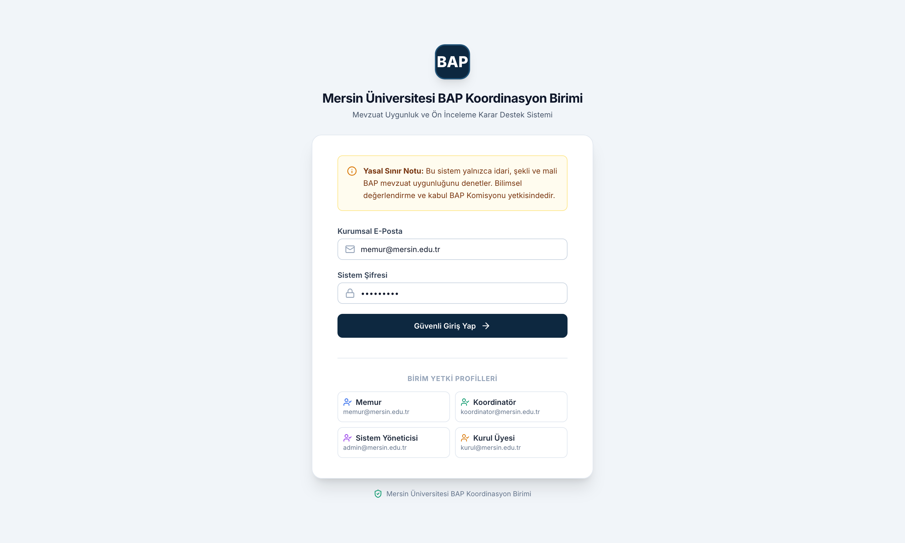
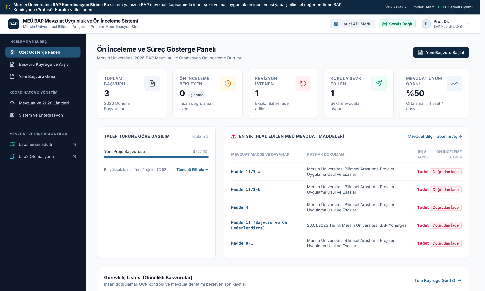
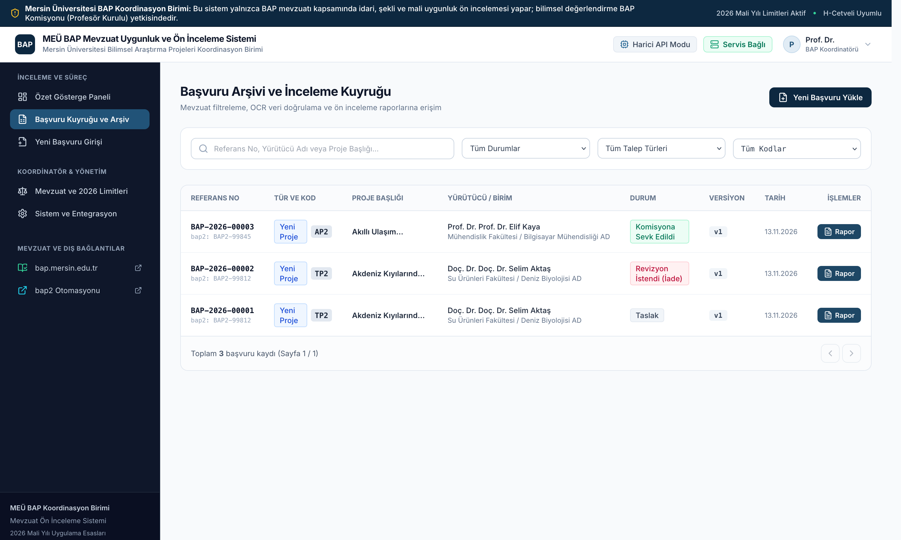
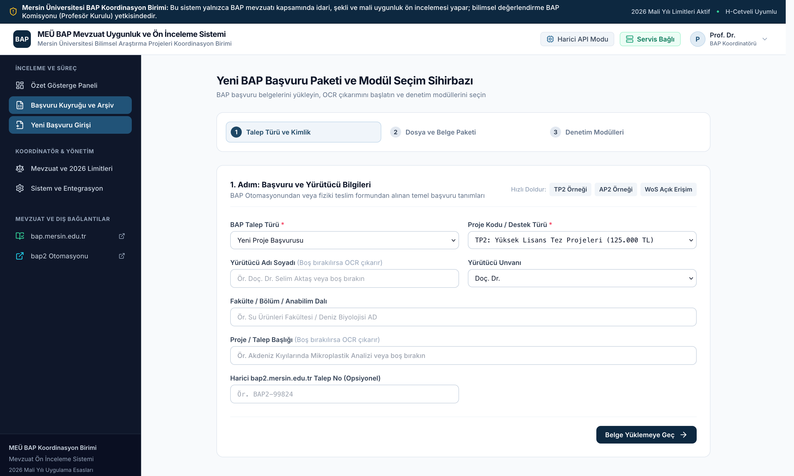
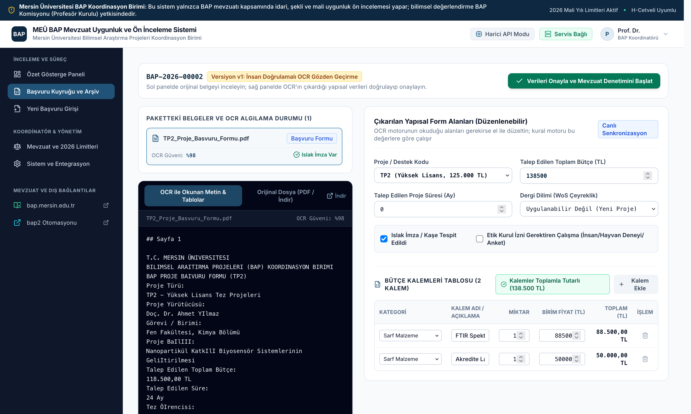
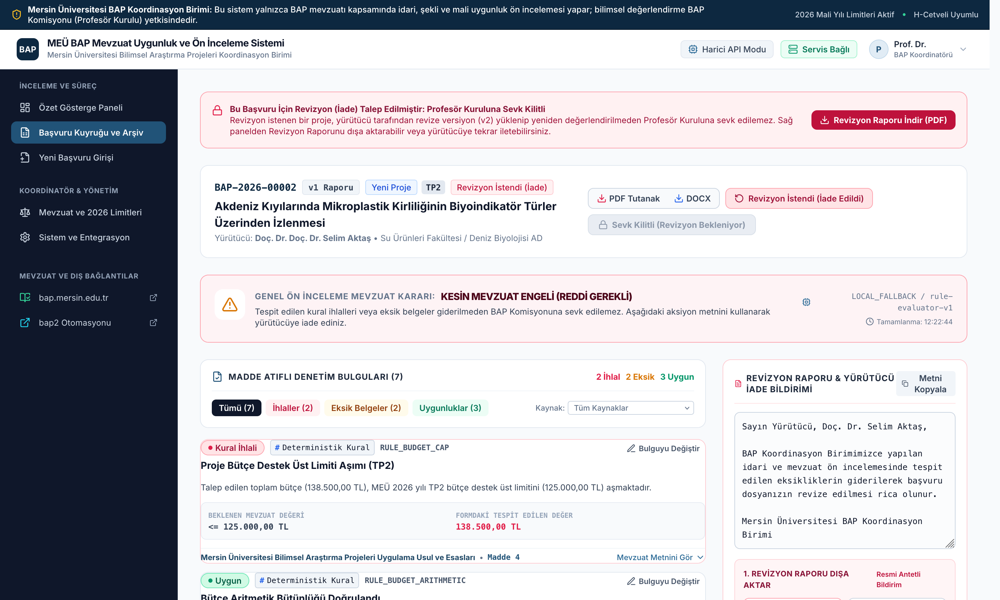
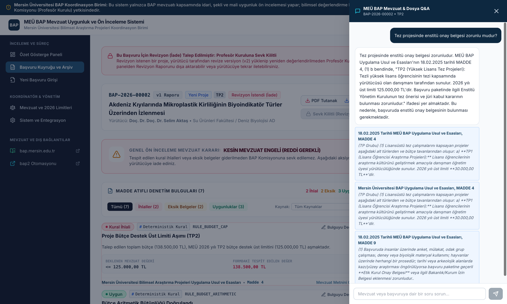
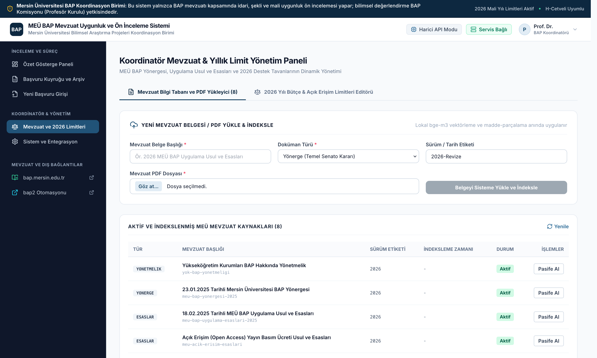

# Mersin Üniversitesi BAP Mevzuat Uygunluk ve Ön İnceleme Sistemi

Mersin Üniversitesi Bilimsel Araştırma Projeleri (BAP) Koordinasyon Birimine ulaşan proje başvurularını ve ek talepleri (yeni proje, ek bütçe, ek süre, satın alma/avans, açık erişim yayın desteği) yürürlükteki mevzuata göre ön incelemeden geçiren karar destek sistemidir.

Sistem yalnızca idari, şekli, belgesel ve mali uygunluk kontrolü yapar. Projenin bilimsel kalitesi, hipotezi veya akademik özgünlüğü hakkında değerlendirme yapmaz; bu yetki tamamen BAP Komisyonuna (Profesör Kurulu) aittir.

---

## Uygulama Ekran Görüntüleri

### 1. Kurumsal Giriş Ekranı


### 2. Ön İnceleme ve Süreç Gösterge Paneli


### 3. Başvuru Kuyruğu ve Arşiv


### 4. Yeni Başvuru Girişi ve Belge Yükleme Sihirbazı


### 5. İnsan Doğrulamalı OCR Çıkarım Kontrolü


### 6. Madde Atıflı Denetim Raporu, Sevk Kilidi ve Revizyon Bildirimi


### 7. Mevzuat ve Dosya Soru-Cevap (RAG Q&A) Çekmecesi


### 8. Koordinatör Mevzuat ve 2026 Yılı Bütçe Limitleri Yönetimi


---

## Docker ile Kurulum ve Çalıştırma

Tüm servisler (`postgres`, `ai-engine`, `core-api`, `web-dashboard`) Docker Compose ile tek komutla ayağa kalkacak şekilde yapılandırılmıştır.

### Gereksinimler
- Docker Engine 24+ ve Docker Compose v2
- En az 4 GB kullanılabilir RAM (`BAAI/bge-m3` lokal vektör modeli için)

### 1. Ortam Değişkenlerini Hazırlayın

Proje kök dizinindeki örnek yapılandırma dosyasını `.env` olarak kopyalayın:

```bash
cp .env.example .env
```

`.env` dosyasında yer alan temel ayarlar:

| Değişken | Varsayılan Değer | Açıklama |
| :--- | :--- | :--- |
| `POSTGRES_DB` | `bap_advisor` | PostgreSQL veritabanı adı (`core` ve `ai_rag` şemalarını barındırır) |
| `POSTGRES_USER` | `bap_user` | Veritabanı kullanıcı adı |
| `POSTGRES_PASSWORD` | `bap_password_change_me` | Veritabanı şifresi |
| `LLM_PROVIDER` | `nanogpt` | Aktif LLM sağlayıcısı (`nanogpt`, `ollama` veya `vllm`) |
| `NANOGPT_API_KEY` | *(boş)* | Harici API modu kullanılacaksa NanoGPT API anahtarı |
| `OLLAMA_BASE_URL` | `http://host.docker.internal:11434/v1` | Lokal Ollama sunucu adresi |
| `OLLAMA_MODEL` | `qwen2.5:14b-instruct` | Lokal Ollama model adı |
| `AIRGAPPED_MODE` | `false` | `true` yapıldığında dış ağa yapılan tüm LLM istekleri engellenir |
| `EMBEDDING_MODEL` | `BAAI/bge-m3` | Lokal çok dilli embedding modeli (1024 boyutlu) |

### 2. Konteynerleri Derleyin ve Başlatın

```bash
docker compose up --build -d
```

İlk çalıştırmada `ai-engine` servisi `BAAI/bge-m3` model ağırlıklarını indirip `huggingface_cache` Docker volume'una kaydeder; sonraki başlatmalarda model önbellekten yüklenir. `data/regulations` ve `data/uploads` dizinleri konteynerlere doğrudan bağlandığı için mevcut mevzuat indeksleri ve yüklenen belgeler korunur.

### 3. Servis Durumunu Kontrol Edin

```bash
docker compose ps
```

Çalışan servislerin erişim adresleri:

- **Web Arayüzü (`web-dashboard`):** http://localhost:3000
- **Core API (`core-api`):** http://localhost:8080/api/v1/health
- **AI Engine (`ai-engine`):** http://localhost:8001/internal/v1/health
- **PostgreSQL 16 (`pgvector`):** `localhost:5432`

### 4. Varsayılan Kullanıcı Hesapları

Sistem ilk kez ayağa kalktığında aşağıdaki kullanıcı profillerini otomatik oluşturur:

| Rol | E-Posta | Şifre | Yetki Kapsamı |
| :--- | :--- | :--- | :--- |
| **BAP Memuru** | `memur@mersin.edu.tr` | `Memur123!` | Başvuru yükleme, OCR kontrolü, denetim çalıştırma, revizyon raporu dışa aktarma ve gönderme |
| **BAP Koordinatörü** | `koordinator@mersin.edu.tr` | `Koord123!` | Memur yetkileri + yıllık bütçe limitlerini ve mevzuat PDF'lerini güncelleme |
| **Sistem Yöneticisi** | `admin@mersin.edu.tr` | `Admin123!` | Tüm sistem ve LLM sağlayıcı (`nanogpt` / `ollama` / `vllm`) ayarları |
| **Komisyon Üyesi** | `kurul@mersin.edu.tr` | `Kurul123!` | Profesör Kuruluna sevk edilen başvuruların ön inceleme raporlarını görüntüleme |

### 5. Servisleri Durdurma

```bash
# Konteynerleri durdur (veritabanı verileri korunur)
docker compose down

# Konteynerleri ve veritabanı volume'unu sıfırlayarak kaldır
docker compose down -v
```

---

## Sistem Mimarisi ve Bileşenler

Proje dört ana bileşenden oluşur:

1. **`apps/web-dashboard` (React 18 + TypeScript + Vite + Nginx):**
   BAP memurları, koordinatör ve komisyon üyeleri için hazırlanan web arayüzü. Docker ortamında Nginx üzerinde çalışır ve `/api/` isteklerini doğrudan `core-api` konteynerine yönlendirir.
2. **`services/core-api` (Java 17 + Spring Boot 3.3):**
   JWT kimlik doğrulaması, başvuru ve versiyon yaşam döngüsü, deterministik sayısal kural motoru, revizyon kilidi ve resmi PDF/DOCX rapor üretimi (`OpenPDF` ve `Apache POI`) işlemlerini yürütür. Verilerini PostgreSQL `core` şemasında tutar.
3. **`services/ai-engine` (Python 3.12 + FastAPI):**
   Çoklu belge ayrıştırma (`PDF`, `DOCX`, `XLSX`, `ZIP`, görsel OCR), ıslak imza/kaşe tespiti, madde bazlı mevzuat parçalama, `BAAI/bge-m3` hibrit vektör arama (yoğun vektör + BM25 + RRF) ve çift modlu LLM ağ geçidi görevlerini üstlenir. Verilerini PostgreSQL `ai_rag` şemasında ve lokal indeks yedeklerinde tutar.
4. **`postgres` (PostgreSQL 16 + `pgvector`):**
   `infra/postgres/init-db.sql` betiği ile `uuid-ossp` ve `vector` eklentilerini etkinleştirir; `core` ve `ai_rag` şemalarını birbirinden izole eder.

---

## Temel Denetim Kuralları ve İş Akışı

- **Deterministik Sayısal Kontroller (Java):**
  - **2026 Bütçe Tavanları:** `TP1` (30.000 TL), `TP2` (125.000 TL), `TP3` (210.000 TL), `AP1` (250.000 TL), `AP2` (300.000 TL), `AP3` (500.000 TL), `AP4` (800.000 TL), `AP7` (100.000 TL), `AP9` (5.000 TL).
  - **Açık Erişim (APC) Tavanları:** `WoS Q1 İlk %10` (120.000 TL), `WoS Q1 Diğer` (80.000 TL), `WoS Q2` (60.000 TL); `Q3`/`Q4` başvuruları reddedilir.
  - **Proje Süresi:** Tez dışı projelerde ek süre dahil toplam süre 36 ayı, yüksek lisans tez projelerinde (`TP2`) 24 ayı aşamaz. Talep edilen sürenin `0 ay` veya boş bırakılması durumunda bulgu **Eksik Belge** (`MISSING_DOCUMENT`) olarak işaretlenir.
  - **Ek Bütçe Sınırı:** Talep edilen ek bütçe, mevcut onaylı bütçenin %50'sini ve ilgili proje türünün 2026 yılı tavanını geçemez.
  - **Proforma ve Teknik Şartname:** 25.000 TL üzeri alımlarda en az 3 proforma fatura, 100.000 TL üzeri teçhizat alımlarında teknik şartname zorunludur.
- **Revizyon ve Kurul Sevk Kilidi:**
  - Hakkında revizyon (`REVISION_REQUESTED`) istenen bir başvuru, yürütücü yeni versiyon (`v2`) yükleyip tekrar denetimden geçmeden Profesör Kuruluna (`COMMISSION_REFERRED`) sevk edilemez.
  - Denetim raporu ekranından resmi antetli **Revizyon Raporu** PDF veya DOCX formatında dışa aktarılabilir ve yürütücüye iade bildirimi olarak gönderilebilir.
- **Çok Turlu Mevzuat ve Dosya Soru-Cevap (Q&A):**
  - Denetim raporu içindeki soru-cevap çekmecesi, hem yürürlükteki MEÜ BAP mevzuat maddelerini hem de başvuruya yüklenen dosyanın OCR metnini ve geçmiş konuşma bağlamını kullanarak madde atıflı yanıt üretir.

---

## Docker Olmadan Lokal Geliştirme (Opsiyonel)

Servisleri Docker kullanmadan doğrudan makinenizde çalıştırmak isterseniz:

```bash
# 1. AI Engine (Python 3.12 + uv)
cd services/ai-engine
uv venv --python 3.12
uv sync
uv run uvicorn app.main:app --host 0.0.0.0 --port 8001

# 2. Core API (Java 17 + Maven Wrapper, H2/local profili ile)
cd services/core-api
./mvnw spring-boot:run -Dspring-boot.run.profiles=local

# 3. Web Dashboard (Node.js + Vite)
cd apps/web-dashboard
npm install
npm run dev
```

### Testleri Çalıştırma

```bash
# Python AI Engine birim ve uçtan uca testleri
cd services/ai-engine && uv run pytest -q

# Java Core API birim ve entegrasyon testleri
cd services/core-api && ./mvnw test

# Web Dashboard tip kontrolü ve üretim derlemesi
cd apps/web-dashboard && npm run build
```
